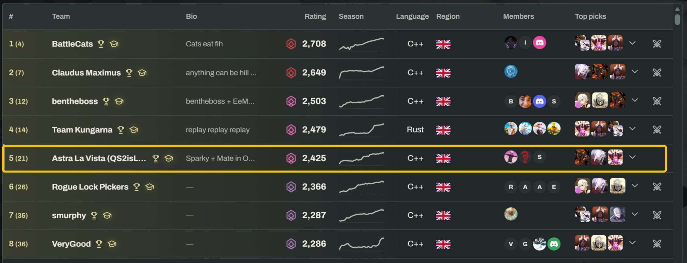

  

<h1 align="center">Cambridge Battlecode 2026: 4th in the UK, Top 12 Worldwide</h1>

  <b>4th of 195 UK teams</b> &nbsp;|&nbsp; <b>Top 12 of 831 teams worldwide</b> &nbsp;|&nbsp; <b>Finalist</b> at the Cambridge Union

  Sponsored by <b>Jane Street</b>, <b>Citadel Securities</b>, <b>Hudson River Trading</b>, <b>G-Research</b>, <b>Anthropic</b>, <b>QRT</b>, 
  <b>QuantCo</b>, <b>Pragma</b>, <b>Hacktron</b> and <b>Pareto</b> &nbsp;|&nbsp; <b>£18,000 prize pool</b> &nbsp;|&nbsp; Cambridge, 12 Oct to 18 Nov 2026

  
  
  
  

---

## The result

**831 teams worldwide. 195 in the UK. 16 seats in the Cambridge Union final. One of them was ours.**

Cambridge Battlecode is a five-week AI programming competition. Each team writes a C++ bot that commands a whole
team of units with no human input, and the bots play each other on a live ladder and then in knockout brackets.

- **4th of 195 UK teams** in the UK qualifier, a double-elimination bracket on maps nobody had seen before
- **Top 12 of 831 teams worldwide** in the international ranking, with a peak ladder rating of 2,425
- **Finalist**, one of the 16 teams invited to play live at the Cambridge Union on 18 November 2026

  

## The game

- **No commander.** Every unit runs its own copy of the program and sees only 8 tiles around itself.
- **8 bytes of shared memory** for the whole team for the whole match, so coordination has to emerge.
- **A hard compute budget.** The bot is compiled to WebAssembly and every instruction counts against it.
- **First team to deliver 1,000 gems wins**, and a unit that dies drops everything it was carrying.

## How we approached it

- **Scale.** Over 2.6 million simulated games on a university supercomputer, and 1,298 bot variants tested.
- **Measurement over intuition.** No change shipped without statistical evidence that it beats the last bot.
- **Automatic tuning.** Dozens of parameters tuned by stochastic optimisation on 64 CPU cores in parallel.
- **Real opponents.** Every candidate was checked in live games against the top teams before an upload.

## Numbers

| | |
|---|---|
| Field | 831 teams worldwide, 195 in the UK |
| Result | 4th UK qualifier, top 12 worldwide, Cambridge Union finalist |
| Ladder | Peak rating 2,425 |
| Testing | 2.6M+ simulated games, 1,298 bot variants |
| Tuning | 64 CPU cores, 40,000+ optimisation evaluations |
| Language | C++ compiled to WebAssembly |

## About this repository

This repository holds the write-up and a small skeleton of the bot. The competitive code stays private.

## Sponsors

  

