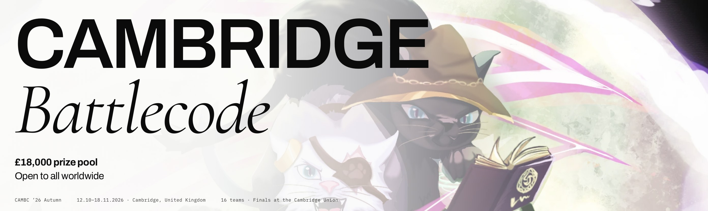
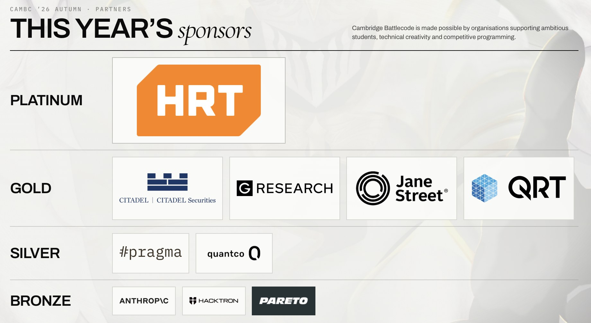

  

<h1 align="center">Autonomous AI armies in C++ for Cambridge Battlecode 2026</h1>

  <b>4th of 195 UK teams</b> in the UK qualifier &nbsp;|&nbsp; <b>Top 12 of 831 teams worldwide</b> &nbsp;|&nbsp; <b>Finalist</b> at the Cambridge Union, 18 November 2026

  Sponsored by <b>Hudson River Trading</b> (Platinum), <b>Citadel | Citadel Securities</b>, <b>G-Research</b>, <b>Jane Street</b>, <b>QRT</b> (Gold), 
  <b>Pragma</b>, <b>QuantCo</b> (Silver), <b>Anthropic</b>, <b>Hacktron</b>, <b>Pareto</b> (Bronze) &nbsp;|&nbsp; <b>£18,000 prize pool</b>

  
  
  
  

---

## The result

**831 teams worldwide. 195 in the UK. 16 seats in the final at the Cambridge Union. One of them was ours.**

Cambridge Battlecode is a five-week AI programming competition. Every team writes a bot that controls a whole army of
units on its own, with no human input once the match starts, and the bots fight each other on a public ladder and then
in elimination tournaments on maps nobody has seen before.

Our team, **Astra La Vista (QS2isLaw)**, finished:

- **4th in the UK qualifier** out of 195 UK teams, in a double-elimination bracket on unseen maps, winning matches 21-0, 20-1 and 21-0 on the way
- **Top 12 internationally** out of 831 teams
- **Finalist**, one of the 16 teams invited to play live at the Cambridge Union on 18 November

  

## Why it is hard

The game is designed so that no single clever trick wins:

- **Every unit runs its own copy of the program.** There is no commander. Each unit sees only **8 tiles** around itself, and teammates do not share vision.
- **The whole team gets 8 bytes of shared memory** for the entire match. Coordination has to emerge from each unit reasoning about what the others will probably do.
- **A hard compute budget of 100,000 fuel per turn.** The C++ is compiled to WebAssembly and every instruction is metered. A single flood fill of the map costs about 87,000, so every algorithm has to be planned against that budget.
- **A draft before every game.** Teams pick champions with different abilities, and the plan has to fit in 1,024 bytes of draft memory.
- **First team to deliver 1,000 gems wins.** Gems are carried by units, and a unit that dies drops everything it carries, so every fight is also an economic decision.

## How we built it

### A testing pipeline, not guesswork

The biggest lesson of the season: **intuition about bots is usually wrong.** So almost all of the engineering went into
measuring things honestly.

- **2.6 million+ simulated games** on the University of Manchester's CSF3 supercomputer, in batches of hundreds of games at a time.
- **1,298 bot variants** built and tested, each one a single measured change.
- **Paired testing.** Every candidate plays the exact same opponents, maps and sides as the current bot, so only the games where the result *changed* count. Same idea as a paired experiment in a lab.
- **Map-clustered bootstrap confidence intervals.** Games on the same map are correlated, so the uncertainty is computed by resampling whole maps. A change ships only when the interval says it is real, not luck.
- **Held-out maps.** Tournaments use unseen maps, so tuning was judged on maps the bot was never tuned on.
- **Real games against the top teams** before every upload, because a local test bench can still mislead.

### Automatic tuning at scale

The bot has dozens of numeric knobs: when to fight, when to retreat, how much gold is worth a trip home. Instead of
setting them by hand, we ran **SPSA (Simultaneous Perturbation Stochastic Approximation)**, the same family of methods
used to tune chess engines, on **64 CPU cores for over 40,000 evaluations**. The tuned bot beat the hand-tuned one by
**+8.9 net wins per 195 games** on held-out maps, with the whole 95% interval above zero.

### Fast, decentralised C++

Each unit decides on its own: where to farm, which fights it can win given its local view, and when to bank gems.
Pathfinding, threat maps and fight evaluation are all written to fit inside the per-turn fuel budget.

## Numbers

| | |
|---|---|
| Field | 831 teams worldwide, 195 in the UK |
| Result | 4th UK qualifier, top 12 international, Cambridge finalist |
| Ladder | 2,425 rating, 5th on the UK ladder |
| Testing | 2.6M+ simulated games on the CSF3 supercomputer |
| Bot variants | 1,298 built and measured |
| Tuning | SPSA on 64 cores, 40,000+ evaluations, +8.9 / 195 games on held-out maps |
| Language | C++ compiled to WebAssembly, 100,000 fuel per turn |

## About this repository

This repository is the write-up and a minimal skeleton of the bot structure. The competitive bot, the tuning pipeline
and the test infrastructure are deliberately kept private. I am happy to walk through the design in person.

## Sponsors

  

The Cambridge Battlecode 2026 final was held at the Cambridge Union.
